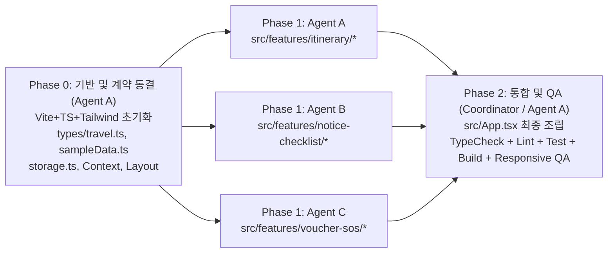

# Travel-Planner-MVP — Multi-Agent 개발 전략서 (Stage 03)

본 문서는 `README.md`의 요구사항과 Stitch 프로젝트(`15535182799094676996`)에 확정된 3개 모바일 화면 디자인을 바탕으로, **Agent A · Agent B · Agent C**가 충돌 없이 병렬로 개발하고 통합·검증하기 위한 아키텍처 및 실행 전략을 정의합니다.

> **디자인 동결 원칙**: Stitch 프로젝트 `15535182799094676996`의 디자인 시스템(`assets/699531e77a0144afbb873551badaeb13`) 및 3개 화면은 확정 상태이며, 본 전략은 해당 디자인을 새로 생성하거나 임의 변경하지 않고 코드로 충실히 구현하는 것을 전제로 합니다.

---

## 0. 참조 Stitch 리소스 요약

| 구분 | 화면 제목 | Stitch Screen ID | 담당 Agent |
| :--- | :--- | :--- | :--- |
| **화면 A** | 여행 일정 (Itinerary) | `d757062d43ab49f7b90712871ddf82d7` | Agent A |
| **화면 B** | 공지 및 체크리스트 | `72663cf098d2430595230bf0844727a3` | Agent B |
| **화면 C** | 바우처 및 긴급정보 (Voucher & SOS) | `7f69f74afc504c0a9e0dbc2c89b7653f` | Agent C |

- **공통 디자인 시스템**: `assets/699531e77a0144afbb873551badaeb13` (`Seoul Minimalist Itinerary`, Light Mode, Deep Navy `#001038` / `#0F2557`, Electric Blue `#0051D5` / `#2563EB`, Surface `#F8F9FF` & `#FFFFFF`)
- **초기 MVP 제외 범위 (추후 `feature/*` 브랜치 예정)**: 현지어 택시 카드 모달, 신규 긴급 SOS 모달, 공백 입력 차단, 최대 글자 수 제한 및 XSS 검증 강화

---

## 1. 전체 프로젝트 디렉터리 구조

기능 단위 모듈화(Feature-sliced Modular Structure)를 채택하여 각 에이전트가 독립된 디렉터리 경계 안에서 작업할 수 있도록 구성합니다.

```text
Travel-Planner-MVP/
├── .github/
│   └── workflows/
│       └── ci.yml                             # GitHub Actions CI (Node.js 20, lint/typecheck/test/build)
├── docs/
│   └── AGENT_PLAN.md                          # Multi-Agent 개발 전략서 (본 문서)
├── public/
│   └── favicon.svg
├── src/
│   ├── main.tsx                               # React 진입점
│   ├── App.tsx                                # 최상위 탭 라우팅 및 Provider 조립
│   ├── index.css                              # Tailwind 지시어, 폰트/Safe-area/기본 스타일
│   ├── types/
│   │   └── travel.ts                          # [공통 계약] 전체 도메인 TypeScript 인터페이스 (Frozen)
│   ├── data/
│   │   └── sampleData.ts                      # 도쿄 2박 3일 초기 샘플 데이터 (일정/공지/체크/바우처/예약/비상)
│   ├── utils/
│   │   └── storage.ts                         # LocalStorage 로드·저장·초기화·폴백 유틸리티
│   ├── context/
│   │   └── TravelPlannerContext.tsx           # 전역 상태 관리 Context & useTravelPlanner 훅
│   ├── components/
│   │   └── layout/
│   │       ├── AppLayout.tsx                  # 모바일(375~430px) 최적화 + 데스크톱 반응형 셸
│   │       ├── TopHeader.tsx                  # 상단 고정 글래스 헤더 + 샘플 초기화 버튼
│   │       ├── BottomNav.tsx                  # 하단 3개 탭 내비게이션 (일정 / 공지·체크 / 바우처·SOS)
│   │       └── ResetConfirmModal.tsx          # 샘플 데이터 초기화 확인 모달
│   └── features/
│       ├── itinerary/                         # [Agent A 전용] 일정 관리 모듈
│       │   ├── ItineraryPage.tsx
│       │   ├── NoticeBanner.tsx               # 일정 화면 상단 공지 요약 배너
│       │   ├── DayTabs.tsx                    # Day 1 / Day 2 / Day 3 세그먼트 탭
│       │   ├── ItineraryTimeline.tsx          # 시간순 세로 타임라인 컨테이너
│       │   ├── ItineraryCard.tsx              # 일정 카드 (시간/장소/활동/메모 + 수정/삭제 버튼)
│       │   ├── ItineraryFormModal.tsx         # 일정 추가 및 수정 바텀시트/모달
│       │   └── index.ts
│       ├── notice-checklist/                  # [Agent B 전용] 공지 및 체크리스트 모듈
│       │   ├── NoticeChecklistPage.tsx
│       │   ├── NoticeCard.tsx                 # 공지사항 1건 조회 카드 + 수정 버튼
│       │   ├── NoticeEditModal.tsx            # 공지사항 제목/내용 수정 모달
│       │   ├── ChecklistProgressCard.tsx      # 실시간 완료 진행률(개수/백분율/프로그레스 바)
│       │   ├── ChecklistList.tsx              # 체크리스트 5건 목록 컨테이너
│       │   ├── ChecklistItemRow.tsx           # 체크박스 토글 항목 카드
│       │   ├── checklistUtils.ts              # 진행률 계산 순수 함수
│       │   └── index.ts
│       └── voucher-sos/                       # [Agent C 전용] 바우처 및 긴급정보 모듈
│           ├── VoucherSosPage.tsx
│           ├── VoucherCard.tsx                # 항공/호텔/관광 바우처 카드 + QR 코드 확인 버튼
│           ├── VoucherQrModal.tsx             # 바우처 QR 코드 바텀시트 모달
│           ├── QrCodeSvg.tsx                  # 오프라인 100% 호환 결정적 SVG QR 렌더러
│           ├── ReservationSummarySection.tsx  # 항공·숙소 핵심 예약 상세 정보 섹션
│           ├── EmergencyContactList.tsx       # 기본 비상연락처 리스트 (110/119/대사관/영사콜센터)
│           └── index.ts
├── index.html                                 # Google Fonts(Plus Jakarta Sans) & 모바일 viewport 메타
├── package.json                               # Node.js 20 호환 의존성 및 스크립트
├── postcss.config.js
├── tailwind.config.js                         # Stitch 디자인 토큰 1:1 매핑 설정
├── tsconfig.json
├── tsconfig.app.json
├── tsconfig.node.json
├── vite.config.ts
├── .nvmrc                                     # 20
└── README.md
```

---

## 2. Agent별 담당 파일 및 책임 매트릭스

| Agent | 핵심 역할 | 독점 담당 파일 / 디렉터리 | 읽기 전용 참조 파일 |
| :--- | :--- | :--- | :--- |
| **Agent A** | 공통 레이아웃, 하단 내비게이션, 공통 `LocalStorage` 상태 관리, 일자별 일정 타임라인 및 일정 CRUD | • `src/types/travel.ts` *(Phase 0 계약 확정)*<br>• `src/data/sampleData.ts`<br>• `src/utils/storage.ts`<br>• `src/context/TravelPlannerContext.tsx`<br>• `src/components/layout/*`<br>• `src/features/itinerary/*`<br>• `src/index.css`, `tailwind.config.js`, `index.html`<br>• `src/App.tsx` *(Phase 2 통합)* | `docs/AGENT_PLAN.md`, `README.md` |
| **Agent B** | 공지사항 조회·수정, 체크리스트 5건, 체크박스 토글, 완료 진행률 실시간 계산 | • `src/features/notice-checklist/*`<br>  (`NoticeChecklistPage.tsx`, `NoticeCard.tsx`, `NoticeEditModal.tsx`, `ChecklistProgressCard.tsx`, `ChecklistList.tsx`, `ChecklistItemRow.tsx`, `checklistUtils.ts`, `index.ts`) | `src/types/travel.ts`, `src/context/TravelPlannerContext.tsx`, `tailwind.config.js` |
| **Agent C** | 바우처 3건, 예약 상세 정보, QR 코드 모달, 기본 비상연락처 | • `src/features/voucher-sos/*`<br>  (`VoucherSosPage.tsx`, `VoucherCard.tsx`, `VoucherQrModal.tsx`, `QrCodeSvg.tsx`, `ReservationSummarySection.tsx`, `EmergencyContactList.tsx`, `index.ts`) | `src/types/travel.ts`, `src/context/TravelPlannerContext.tsx`, `tailwind.config.js` |

### Agent별 Context 소비 계약
- **Agent A 제공 액션 (`useTravelPlanner()`)**:
  - 상태: `state`, `activeTab`, `setActiveTab`, `resetToSampleData`
  - 일정(Agent A): `addItineraryItem`, `updateItineraryItem`, `deleteItineraryItem`
  - 공지·체크(Agent B): `updateNotice`, `toggleChecklistItem`
  - 바우처·SOS(Agent C): `state.vouchers`, `state.reservations`, `state.emergencyContacts`

---

## 3. 공통 TypeScript 인터페이스 (`src/types/travel.ts`)

`README.md`의 데이터 스키마와 Stitch 화면에 표시되는 UI 메타데이터(카테고리 배지, 상태 라벨 등)를 정합성 있게 통합한 공통 계약입니다.

```ts
export const STORAGE_KEY = 'travel-planner-mvp:v1';
export const SCHEMA_VERSION = 1;

export type AppTab = 'itinerary' | 'notice-checklist' | 'voucher-sos';
export type TripDay = 1 | 2 | 3;

export interface TripMeta {
  title: string;          // 예: "도쿄 2박 3일 여행"
  destination: string;    // 예: "Tokyo, Japan"
  durationLabel: string;  // 예: "2박 3일"
  startDate: string;      // YYYY-MM-DD
  endDate: string;        // YYYY-MM-DD
  dayLabels: Record<TripDay, string>; // 예: { 1: "11.27 (금)", 2: "11.28 (토)", 3: "11.29 (일)" }
}

// 1. 일정 관리 (Agent A)
export type ItineraryCategory = '공항/교통' | '숙소' | '관광' | '야경/식사' | '맛집/카페' | '쇼핑' | '기타';

export interface ItineraryItem {
  id: string;
  day: TripDay;
  time: string;                // "HH:mm" (예: "09:30")
  location: string;            // 장소명
  activity: string;            // 주요 활동
  memo: string;                // 상세 메모
  category?: ItineraryCategory;// 선택 카테고리 배지 (Stitch 카드 배지용)
}

export type ItineraryItemInput = Omit<ItineraryItem, 'id'>;

// 2. 공지 및 체크리스트 (Agent B)
export interface NoticeItem {
  id: string;
  title: string;
  content: string;
  updatedAt: string;           // ISO 8601 문자열
}

export interface NoticeUpdateInput {
  title: string;
  content: string;
}

export interface ChecklistItem {
  id: string;
  label: string;
  completed: boolean;
  category?: string;           // 예: "필수서류" | "통신" | "결제" | "전자기기" | "입국준비"
}

export interface ChecklistProgress {
  completedCount: number;
  totalCount: number;
  remainingCount: number;
  percentage: number;          // 0 ~ 100 정수
}

// 3. 바우처 및 긴급정보 (Agent C)
export type VoucherCategory = 'FLIGHT' | 'HOTEL' | 'TRANSPORT' | 'TICKET';

export interface VoucherItem {
  id: string;
  title: string;
  provider: string;
  category: VoucherCategory;
  categoryLabel: string;       // 예: "항공권" | "호텔" | "관광"
  statusLabel: string;         // 예: "확약됨" | "결제완료" | "즉시입장"
  reservationCode: string;
  validDate: string;           // 이용 일시/정보 요약
  location: string;
  qrPayload: string;           // QR SVG 생성용 고유 문자열
  notes?: string;              // 모달 하단 상세 안내
}

export type ReservationType = 'FLIGHT' | 'ACCOMMODATION' | 'OTHER';

export interface ReservationInfo {
  id: string;
  type: ReservationType;
  title: string;
  reservationNumber: string;
  schedule: string;
  detail: string;
}

export type EmergencyCategory = 'POLICE' | 'MEDICAL' | 'EMBASSY' | 'SUPPORT';

export interface EmergencyContact {
  id: string;
  name: string;
  phone: string;
  description: string;
  badgeText?: string;          // 예: "영사부" | "연중무휴 24h"
  category: EmergencyCategory;
}

// 루트 상태 스키마
export interface TravelPlannerState {
  schemaVersion: number;
  tripMeta: TripMeta;
  itinerary: ItineraryItem[];
  notice: NoticeItem;
  checklist: ChecklistItem[];
  vouchers: VoucherItem[];
  reservations: ReservationInfo[];
  emergencyContacts: EmergencyContact[];
}

// Context 공개 계약
export interface TravelPlannerContextValue {
  state: TravelPlannerState;
  activeTab: AppTab;
  setActiveTab: (tab: AppTab) => void;
  addItineraryItem: (input: ItineraryItemInput) => void;
  updateItineraryItem: (id: string, input: ItineraryItemInput) => void;
  deleteItineraryItem: (id: string) => void;
  updateNotice: (input: NoticeUpdateInput) => void;
  toggleChecklistItem: (id: string) => void;
  resetToSampleData: () => void;
}
```

---

## 4. LocalStorage 데이터 구조 및 영속성 전략

### 4.1 저장 키 및 JSON 페이로드 구조
- **Key**: `travel-planner-mvp:v1` (단일 원자적 키 사용으로 초기화 및 마이그레이션 단순화)
- **직렬화 형식**: `JSON.stringify(TravelPlannerState)`

```json
{
  "schemaVersion": 1,
  "tripMeta": {
    "title": "도쿄 2박 3일 여행",
    "destination": "Tokyo, Japan",
    "durationLabel": "2박 3일",
    "startDate": "2026-11-27",
    "endDate": "2026-11-29",
    "dayLabels": {
      "1": "11.27 (금)",
      "2": "11.28 (토)",
      "3": "11.29 (일)"
    }
  },
  "itinerary": [
    {
      "id": "itn-1",
      "day": 1,
      "time": "09:30",
      "location": "나리타 국제공항",
      "activity": "입국 수속 및 N'EX 탑승",
      "memo": "제1터미널 지하 1층 매표소에서 QR 교환",
      "category": "공항/교통"
    }
  ],
  "notice": {
    "id": "notice-main",
    "title": "입국 및 숙소 체크인 핵심 안내",
    "content": "나리타 공항 제1터미널 도착 후 지하 1층 JR 매표소에서 N'EX 티켓을 교환하세요. 신주쿠 그레이스리 호텔 체크인은 오후 3시이며, 여권과 예약 바우처를 지참해야 합니다.",
    "updatedAt": "2026-11-26T09:00:00.000Z"
  },
  "checklist": [
    { "id": "chk-1", "label": "여권 및 항공권 e-티켓 모바일 저장", "completed": true, "category": "필수서류" }
  ],
  "vouchers": [
    {
      "id": "vch-1",
      "title": "인천(ICN) → 도쿄 나리타(NRT) 왕복 항공권",
      "provider": "대한항공",
      "category": "FLIGHT",
      "categoryLabel": "항공권",
      "statusLabel": "확약됨",
      "reservationCode": "KE703-8821",
      "validDate": "11.27(금) 07:10 출발 · 제2여객터미널",
      "location": "인천국제공항 제2여객터미널",
      "qrPayload": "FLIGHT|KE703-8821|ICN-NRT|2026-11-27",
      "notes": "탑승구 249번 / 좌석 28A"
    }
  ],
  "reservations": [
    {
      "id": "rsv-1",
      "type": "FLIGHT",
      "title": "왕복 항공편 (KE703 / KE704)",
      "reservationNumber": "KE703-8821",
      "schedule": "출국 11.27 07:10 / 귀국 11.29 19:50",
      "detail": "인천(ICN) T2 ↔ 도쿄 나리타(NRT) T1"
    }
  ],
  "emergencyContacts": [
    {
      "id": "sos-1",
      "name": "일본 경찰 신고",
      "phone": "110",
      "description": "범죄·분실·사고 긴급 신고",
      "category": "POLICE"
    }
  ]
}
```

### 4.2 안정성 및 폴백 규칙 (`src/utils/storage.ts`)
1. **초기 로드 (`loadTravelState`)**:
   - `window.localStorage.getItem(STORAGE_KEY)` 호출
   - 값이 없거나, JSON 파싱 실패, `schemaVersion !== 1`, 필수 배열(`itinerary`, `checklist`, `vouchers`, `reservations`, `emergencyContacts`) 또는 `notice` 누락 시 `createInitialSampleState()`의 깊은 복사본(deep clone)을 반환하고 스토리지를 정상 복구
2. **자동 저장 (`saveTravelState`)**:
   - `TravelPlannerContext`의 상태 갱신 시 `useEffect` 또는 상태 업데이트 핸들러에서 즉시 저장
   - 사파리 프라이빗 모드/용량 초과(`QuotaExceededError`) 발생 시 앱 크래시 없이 콘솔 경고로 안전 처리
3. **샘플 데이터 초기화 (`resetTravelState`)**:
   - `localStorage.removeItem(STORAGE_KEY)` 후 새 샘플 상태를 저장·반영
   - `TopHeader`의 초기화 버튼 클릭 시 확인 모달(`ResetConfirmModal`)을 거쳐 실수 방지
4. **파생 상태 비저장 원칙**:
   - `ChecklistProgress`(완료 건수·백분율)와 `itinerary` 시간순 정렬 결과는 `LocalStorage`에 중복 저장하지 않고 렌더링 시 `useMemo`로 실시간 계산

---

## 5. 에이전트 간 파일 수정 충돌 방지 전략

### 5.1 3단계 실행 파이프라인 (Contract-First Isolation)



### 5.2 충돌 방지 5대 규칙
1. **디렉터리 배타적 소유권 (Disjoint Write Scope)**:
   - Phase 1 병렬 구현 중 각 에이전트는 자신의 `src/features/<module>/*` 디렉터리 내부 파일만 생성·수정합니다.
   - `src/types/travel.ts`, `src/context/TravelPlannerContext.tsx`, `src/App.tsx`, `package.json`, `tailwind.config.js`는 Phase 1 동안 **Read-Only(동결)** 상태를 유지합니다.
2. **Barrel Export 계약 (`index.ts`)**:
   - 각 모듈은 `index.ts`에서 단일 페이지 컴포넌트(`ItineraryPage`, `NoticeChecklistPage`, `VoucherSosPage`)만 외부로 export합니다. 내부 하위 컴포넌트 구조 변경이 다른 에이전트에 전혀 영향을 주지 않습니다.
3. **단일 상태 진입점 (`useTravelPlanner`)**:
   - Agent B와 Agent C는 `localStorage`를 직접 읽고 쓰지 않으며, 오직 Agent A가 Phase 0에서 확정해 둔 `useTravelPlanner()` 훅의 상태와 액션 메서드만 호출합니다.
4. **공통 스타일 수정 금지**:
   - `src/index.css`와 `tailwind.config.js`의 Stitch 디자인 토큰은 Phase 0에서 확정되며, Agent B/C는 유틸리티 클래스 조합으로만 스타일링합니다.
5. **계약 변경 프로토콜**:
   - Phase 1 도중 공통 인터페이스 변경이 불가피할 경우, 에이전트가 `src/types/travel.ts`를 직접 수정하지 않고 변경 요청을 Coordinator에게 보고한 뒤 Phase 2 통합 단계에서 일괄 반영합니다.

---

## 6. Stitch 디자인을 실제 코드에 적용하는 방법

Stitch MCP(`download_file`)로 확보한 3개 화면의 실제 HTML 및 Tailwind 토큰을 분석한 결과, 모든 화면이 **동일한 디자인 토큰과 모바일 탭 셸**을 공유합니다.

### 6.1 Stitch 디자인 토큰 → `tailwind.config.js` 1:1 이식
Stitch HTML의 `<script id="tailwind-config">`에 정의된 컬러·타이포그래피·간격 토큰을 프로젝트 `tailwind.config.js`의 `theme.extend`에 그대로 옮깁니다.

| 토큰 카테고리 | Stitch 정의 값 | 코드 적용 용도 |
| :--- | :--- | :--- |
| **배경/서피스** | `surface: #f8f9ff`, `surface-container-lowest: #ffffff`, `surface-container-low: #eff4ff`, `surface-container: #e5eeff`, `surface-container-high: #dce9ff` | 앱 캔버스(`#f8f9ff`), 카드·헤더·하단바(`#ffffff`), 공지·메모·예약상세 박스(`#eff4ff`), 탭 트랙·프로그레스 트랙(`#e5eeff`) |
| **브랜드/강조** | `primary: #001038`, `primary-container: #0f2557`, `secondary: #0051d5`, `secondary-container: #316bf3`, `secondary-fixed: #dbe1ff` | 주요 제목·활성 Day 탭·QR 확인 버튼(네이비), `+ 일정 추가`·활성 하단탭·타임라인 노드·완료 체크박스·프로그레스 바(블루) |
| **텍스트/보더** | `on-surface: #0b1c30`, `on-surface-variant: #44464f`, `outline: #757680`, `outline-variant: #c5c6d0`, `error: #ba1a1a` | 본문/보조 텍스트, 완료 취소선, 삭제 버튼 호버 |
| **타이포그래피** | `Plus Jakarta Sans` + 한국어 폴백(`"Pretendard Variable", Pretendard, -apple-system, sans-serif`) | `headline-xl(30px)` ~ `label-sm(11px)` 스케일 그대로 등록 |
| **라운드/그림자** | 카드 `rounded-xl`(12px) / `rounded-2xl`(16px), 버튼 `rounded-xl`, 배지 `rounded-full` | `shadow-[0_2px_8px_-2px_rgba(15,37,87,0.05),0_1px_3px_rgba(15,37,87,0.03)]` 적용 |

### 6.2 Stitch HTML → React 컴포넌트 전환 가이드
1. **외부 CDN 스크립트 제거**: Stitch 프로토타입의 `cdn.tailwindcss.com` 런타임 스크립트는 제거하고 Vite + PostCSS 기반 정적 빌드 Tailwind CSS로 전환합니다.
2. **아이콘 오프라인 안정화**: Stitch HTML의 Material Symbols 아이콘(`calendar_month`, `fact_check`, `confirmation_number`, `add`, `edit`, `delete_outline`, `campaign`, `qr_code_2`, `call`, `check` 등)을 `lucide-react` 벡터 SVG 아이콘으로 1:1 매핑하여 네트워크 지연이나 오프라인 환경에서도 아이콘 깨짐(FOIC)을 방지합니다.
3. **일정 카드 이미지 처리**: 화면 A 프로토타입에 포함된 임시 외부 이미지 URL(`lh3.googleusercontent.com`)은 만료·오프라인 취약점이 있으므로 제거하고, 핵심 요구사항 필드(시간, 카테고리 배지, 장소, 활동, 메모, 수정/삭제 버튼) 중심의 깔끔한 카드로 구현합니다.
4. **공통 헤더 정제**: 프로토타입의 영문 임시 헤더(`Itinerary` + `Search` 아이콘)를 한국어 브랜드 타이틀(`Travel Planner · 도쿄`)과 요구사항에 정의된 **샘플 초기화** 버튼으로 정제하되, Stitch의 고정 글래스 헤더(`h-14`, `backdrop-blur-xl`) 높이와 여백은 동일하게 유지합니다.
5. **모바일(375~430px) + 데스크톱 반응형 대응**:
   - 모바일(`375px ~ 430px`): 풀-폭 단일 컬럼 + 좌우 `16px`(`px-4`) 마진 + 하단 고정 3탭 바(`h-16` + `pb-safe`)
   - 태블릿/데스크톱(`md:` 이상): `max-w-xl`(576px) ~ `max-w-2xl`(672px) 중앙 정렬 앱 컨테이너에 은은한 좌우 보더/그림자를 적용하고, 바우처 카드 등은 넓은 화면에서 가독성이 유지되도록 반응형 패딩과 그리드를 조정합니다.
6. **화면 C QR 코드 모달**: Stitch 화면 C의 하단 시트(`rounded-t-3xl`, 반투명 네이비 백드롭, SVG QR 코드 영역, 예약번호 모노스페이스 표기, 화면 밝기 안내, 닫기 버튼)를 `VoucherQrModal.tsx`로 그대로 구현합니다.

---

## 7. 의존성 및 Node.js 20 호환성 검토

현재 로컬 환경은 Node.js `v24.x`이나, **GitHub Actions CI 및 Vercel 배포 요구사항은 Node.js 20 환경**입니다. Vite 7+/Tailwind v4 등 최신 메이저 버전에서 발생할 수 있는 Node 20 마이너 버전 제약(`^20.19.0`)이나 네이티브 바이너리 이슈를 원천 차단하기 위해 **Node.js 20 LTS 전 구간에서 검증된 안정 버전 조합**을 채택합니다.

### 7.1 권장 의존성 매트릭스

| 패키지 | 권장 버전 | 용도 | Node.js 20 호환성 |
| :--- | :--- | :--- | :--- |
| `react`, `react-dom` | `^18.3.1` | UI 프레임워크 | 완벽 호환 (테스트 라이브러리 피어 의존성 충돌 없음) |
| `typescript` | `~5.6.3` | 정적 타입 검사 | 완벽 호환 |
| `vite` | `^5.4.11` | 개발 서버 및 프로덕션 번들러 | Node `>=18.0.0` (모든 Node 20.x 완벽 지원) |
| `@vitejs/plugin-react` | `^4.3.4` | React Fast Refresh / JSX 변환 | Vite 5 완벽 호환 |
| `tailwindcss` | `^3.4.17` | 유틸리티 CSS (Stitch config 직접 호환) | Node `>=14.0.0` (네이티브 바인딩 리스크 없음) |
| `postcss`, `autoprefixer` | `^8.4.49`, `^10.4.20` | Tailwind CSS 파이프라인 | 완벽 호환 |
| `lucide-react` | `^0.468.0` | 경량 SVG 아이콘 (오프라인 안전) | React 18 완벽 호환 |
| `vitest`, `jsdom` | `^2.1.8`, `^25.0.1` | 단위·컴포넌트 테스트 러너 | Vite 5 + Node 20 완벽 호환 |
| `@testing-library/react`, `@testing-library/jest-dom` | `^16.0.1`, `^6.6.3` | UI 인터랙션 검증 | React 18 + Vitest 2 완벽 호환 |
| `eslint`, `@eslint/js`, `typescript-eslint`, `eslint-plugin-react-hooks`, `eslint-plugin-react-refresh` | `^9.15.0` 계열 | 코드 품질 및 정적 분석 | Node `>=18.18.0` (Node 20 완벽 지원) |

### 7.2 CI 및 Vercel 호환 설정
- **`package.json`**:
  - `"engines": { "node": ">=20.0.0" }` 명시
  - 표준 스크립트: `dev`, `build` (`tsc -b && vite build`), `lint`, `test` (`vitest run`), `typecheck` (`tsc --noEmit`), `preview`
- **`.nvmrc`**: `20` 명시 (Vercel 및 로컬 nvm 자동 인식)
- **Vercel 호환**: 순수 클라이언트 SPA이므로 별도 서버리스 함수나 환경 변수 없이 `vite build` → `dist/` 출력으로 즉시 배포 가능. (탭 전환을 React State 기반으로 처리하면 SPA 리라이트 설정 없이도 404 문제 제로)
- **GitHub Actions CI**: `actions/setup-node@v4`에 `node-version: 20` 및 `cache: 'npm'` 고정, `npm ci` → `npm run typecheck` → `npm run lint` → `npm run test` → `npm run build` 순으로 실행.

---

## 8. 통합 및 QA 계획

### 8.1 단계별 통합 절차 (Phase 2)
1. **모듈 조립**: `src/App.tsx`에서 `TravelPlannerProvider`로 `AppLayout`을 감싸고, `activeTab` 값에 따라 `ItineraryPage`, `NoticeChecklistPage`, `VoucherSosPage`를 조건부 렌더링합니다.
2. **크로스 모듈 연동 확인**:
   - Agent B의 공지 수정(`updateNotice`) 결과가 Agent A의 `ItineraryPage` 상단 공지 배너에 즉시 반영되는지 확인합니다.
   - `TopHeader`의 **샘플 데이터 초기화** 실행 시 Agent A(일정), Agent B(공지·체크리스트), Agent C(바우처·연락처) 모든 화면이 초기 샘플 상태로 일괄 복원되는지 확인합니다.

### 8.2 자동화 검증 게이트 (CI 기준)
| 단계 | 명령어 | 합격 기준 |
| :--- | :--- | :--- |
| **1. 타입 체크** | `npm run typecheck` | TypeScript 컴파일 에러 0건 (`strict: true`) |
| **2. 정적 분석** | `npm run lint` | ESLint 에러/경고 0건 |
| **3. 단위/기능 테스트** | `npm run test` | Storage 폴백/저장/초기화, 일정 CRUD 및 시간순 정렬, 공지 수정, 체크리스트 토글 및 진행률 계산, 바우처 QR 모달 열기/닫기 테스트 전체 통과 |
| **4. 프로덕션 빌드** | `npm run build` | `dist/` 번들 정상 생성 (Node.js 20 환경 기준) |

### 8.3 기능 및 UI/UX 수동 QA 체크리스트
- **일정 관리 (Agent A)**:
  - [ ] Day 1 / Day 2 / Day 3 탭 전환 시 해당 일자의 일정만 시간순(`HH:mm`)으로 표시됨
  - [ ] 일정 추가 → 수정 → 삭제 동작이 즉시 UI와 `LocalStorage`에 반영됨
  - [ ] 새로고침 후에도 변경된 일정이 그대로 유지됨
- **공지 및 체크리스트 (Agent B)**:
  - [ ] 공지사항 1건 조회 및 수정 시 본문·수정 시각이 즉시 업데이트되고 일정 탭 상단 배너에도 동기화됨
  - [ ] 체크리스트 5건 각각의 토글 클릭 시 체크 상태, 완료/남음 건수, 백분율(`0% ~ 100%`), 프로그레스 바 너비가 실시간 계산됨
- **바우처 및 긴급정보 (Agent C)**:
  - [ ] 항공권·호텔·관광 바우처 3건과 예약 상세 정보가 정상 표시됨
  - [ ] 각 바우처의 `QR 코드 확인` 버튼 클릭 시 해당 바우처 제목·예약번호·SVG QR 코드가 모달에 표시되고 닫기/백드롭 클릭/ESC로 닫힘
  - [ ] 기본 비상연락처(110, 119, 주일 대한민국 대사관, 외교부 영사콜센터)가 `tel:` 링크와 함께 정상 표시됨
- **공통 및 반응형 / 범위 준수**:
  - [ ] 모바일 뷰포트 `375px`, `390px`, `430px`에서 가로 스크롤(`overflow-x`) 없음 및 터치 타겟(`>=44px`) 확보
  - [ ] 데스크톱 뷰포트(`1280px`)에서 중앙 정렬 컨테이너 및 레이아웃 균형 유지
  - [ ] `샘플 데이터 초기화` 실행 시 확인 모달 표시 및 초기 도쿄 2박 3일 데이터 복구 완료
  - [ ] **제외 범위 검증**: 현지어 택시 카드 모달, 신규 긴급 SOS 모달, 공백 입력 차단/최대 글자 수 제한/XSS 강화 로직이 사전 구현되지 않았는지 확인
